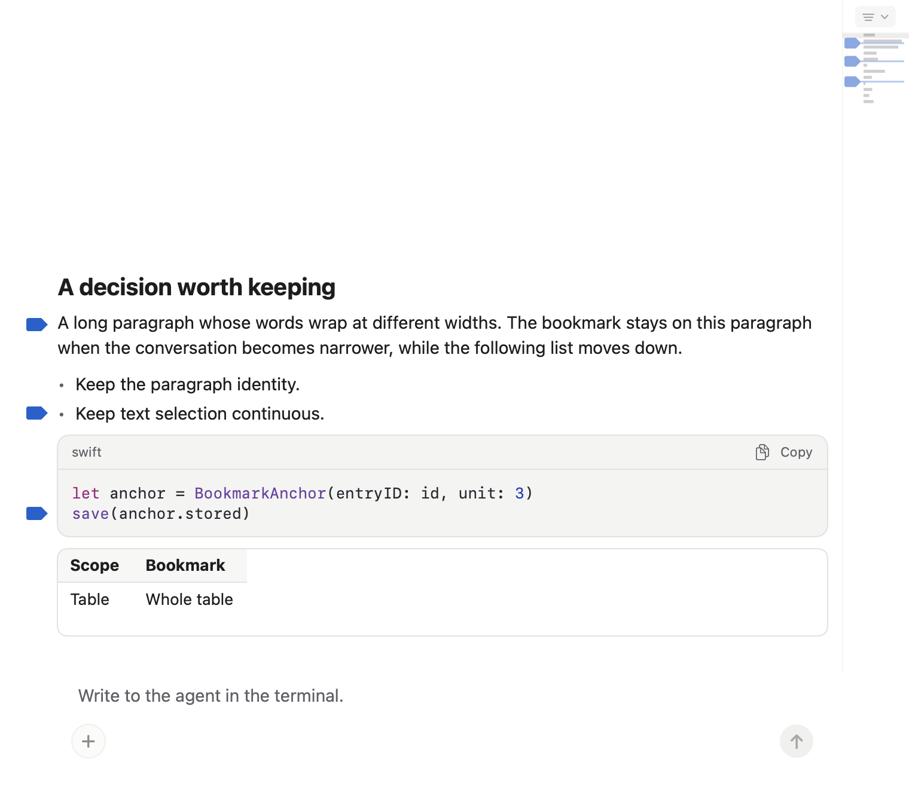
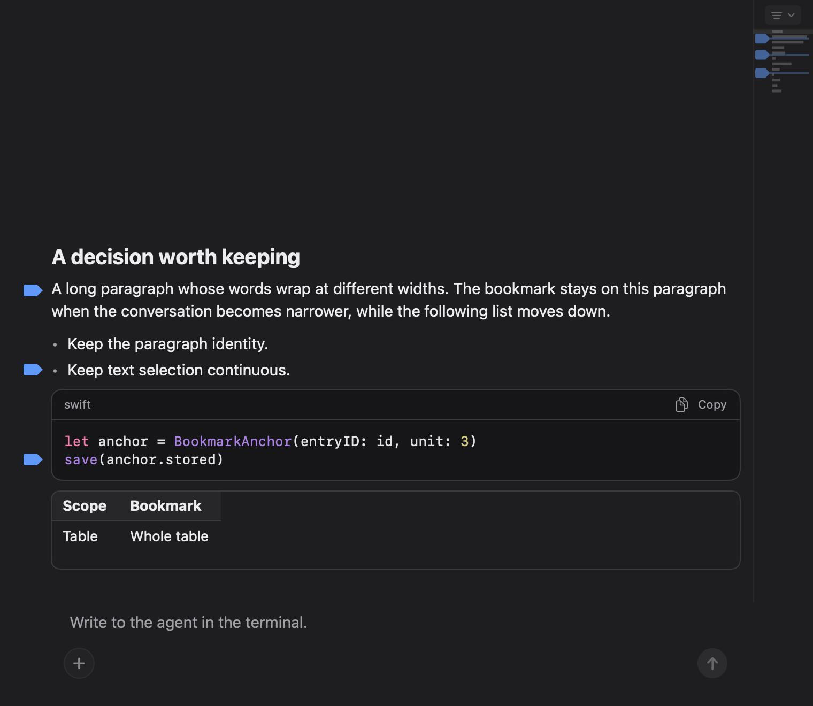

# Ticket validation report — #594

A bookmark marks a semantic paragraph, a code line or a whole table. The decisions confirmed
on the ticket on 2026-11-23 are implemented on top of `main`, including #591 and #592.

## Requirements checklist

| Requirement | Status | Evidence |
| --- | --- | --- |
| Headings, paragraphs, nested list paragraphs and quotes; no unit for a rule | IMPLEMENTED | `MarkdownUnits`, `MarkdownProse` paragraph attributes; `semanticUnits` |
| One unit per logical code line, including blank lines; one per table | IMPLEMENTED | `MarkdownUnits.ranges`; `semanticUnits` |
| Multiple independent anchors per message; legacy identifiers mean unit zero | IMPLEMENTED | `BookmarkAnchor`, `ConversationBookmarks`; `storage`, `independentParagraphs` |
| A hovered tag follows the paragraph's first line and toggles that unit | IMPLEMENTED | `BlockRow`, `ParagraphBookmarkLayout`, `BookmarkGutter`; `followsParagraphAcrossWidths` |
| Ordinary rows do not measure paragraph geometry | IMPLEMENTED | Optional row tracker; `ordinaryRowsDoNotMeasureUnits` (zero trackers, then exactly one for a marked row) |
| Overview lines use estimated, then measured unit offsets | IMPLEMENTED | `ConversationMoments.Placed`, `ConversationOverview.momentTop`; `overviewLinesNameTheirUnit`, `measuredPositionsReplaceEstimates` |
| An overview click reveals and lights only the touched unit | IMPLEMENTED | `revealMoment`, exact `LitPassage.segment/range`, TextKit lighting; `overviewLinesNameTheirUnit` |
| Next/Previous visit several units inside the same message | IMPLEMENTED | `revealNextMoment`, `revealPreviousMoment`; `keyboardAndNavigation`, `manualScrollForgetsAUnitThatLeftTheViewport` |
| ⌘B uses the beginning of the selection, otherwise the first fully visible first line | IMPLEMENTED | `selectedBookmarkPlace`, `firstVisibleBookmarkPlace`; `keyboardAndNavigation` |
| Prompts, answers, reasoning and standalone plans; tool/sub-agent groups stay whole | IMPLEMENTED | `bookmarkContents`, selection source and block environments; `plainPromptsAndPlans`, existing grouped-tool tests |
| Accessible marked units and a message action; translated labels | IMPLEMENTED | Each gutter tag exposes its passage as its value; focused accessible text range for the message action; existing translated add/remove labels |
| Documentation in English and French | IMPLEMENTED | `site/docs/{en,fr}/conversation.html`, ADR 0025, `docs/accessibility.md` |

## Test coverage and visual review

`swift test --package-path Packages/VibeManagerKit --filter 'Bookmark|MarkdownUnits|MarginPreview'`
passes: **89 tests**. The new offscreen-host tests verify first-line geometry, marking the unit
under the pointer, reflow at 600 and 300 points, exact range highlighting, and that unmarked
rows allocate no paragraph trackers. No test opens a window on screen.

The full conversation is rendered offscreen in light and dark mode. The captures below were
visually inspected: the three tags align with a paragraph, a list item and the second code line.
The screenshot test can reproduce them with `BOOKMARK_SNAPSHOT_DIR=/tmp/bookmark-snapshots`.

The full package passes **4,413 tests**, after a build with warnings treated as errors.
The localization checks (all 17 languages), external-open checks and site build pass. Full
`Scripts/ci.sh` results are recorded in the pull request.

## Limits of validation

The live 120 Hz A/B benchmark described in #573 was not repeated: its temporary executable was
not committed to the repository. The offscreen test guards the allocation/measurement boundary,
not frame rate. VoiceOver's focused text range is supported, but a spoken end-to-end VoiceOver
walkthrough has not been performed.

## Verdict

**COMPLETE** for the functional requirements above. The live performance measurement and spoken
VoiceOver walkthrough remain manual validation, as distinguished from the automated checks.

## Follow-up — non-text margin tags

The manual recording exposed a lifetime bug: leaving a tool group or an unshared-reasoning
row's body removed its unmarked tag before the pointer could enter the margin. Those rows have
no paragraph tracker to keep the tag mounted across that transition.

`BookmarkGutterUnits` now keeps the single whole-block tag mounted independently of transient
hover state. Text rows still keep only marked units when neither hovered nor tracked.
`NonTextBookmarkGutterTests` renders the actual tag collection in an offscreen host with native
buttons: the same button must remain present after body hover ends, and its clicks must set and
remove the whole-block bookmark. Both tool-group and unshared-reasoning cases fail with the old
selection rule, and pass with the fix. A third case checks that text-row candidates disappear
while their marked tags remain.

A focused SwiftPM harness, depending on the repository's actual UI/domain/application products,
ran the new tests together with `BookmarkTests`, `MarkdownUnitsTests` and
`ParagraphBookmarkLayoutTests`: **45 tests passed**. Formatting, localization checks and
`git diff --check` also pass. The earlier full-suite numbers above belong to the initial feature;
the follow-up was checked with this focused suite.

## Follow-up — unshared-reasoning preview label

An unshared reasoning entry has no tool execution state. Its bookmark excerpt previously fell
through to the tool accessibility title, whose missing-state fallback is “succeeded”. It now
uses the existing, fully translated “Reasoning not shared by the agent” label, as the row does.
`unsharedReasoningBookmarkDescribesTheReasoning` covers the excerpt, accessibility label and
both margin/overview previews; all four assertions fail before the fix.

The focused bookmark/geometry/navigation suite passes **46 tests** after this correction;
localization and formatting checks also pass.
